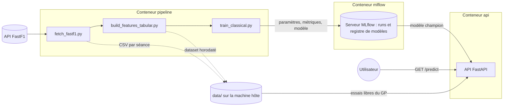

# F1 Quali Time Predictor

Prédire l'ordre du top 10 de la qualification d'un Grand Prix de Formule 1 à partir de ses essais libres (FP1 à FP3) et de la forme récente des pilotes, avec les données de [FastF1](https://github.com/theOehrly/Fast-F1).

Ce projet de portfolio met autant l'accent sur les **pratiques MLOps** que sur la modélisation : suivi des expériences et registre de modèles avec MLflow, API de prédiction, conteneurisation avec Docker et tests automatisés.

**En bref**
- Un modèle de classement (`XGBRanker`) qui ordonne les pilotes de chaque Grand Prix, évalué par validation croisée temporelle sur 82 Grands Prix (2022-2026).
- Spearman moyen de **0,627**, contre **0,544** pour l'ordre des essais libres, une référence volontairement exigeante.
- Une prédiction disponible entre la dernière séance d'essais et la qualification, par une API ou en ligne de commande.

## Architecture



1. **Collecte** : `fetch_fastf1.py` télécharge les séances depuis FastF1 et les écrit en CSV dans `data/raw/`.
2. **Features** : `build_features_tabular.py` construit un dataset (une ligne par pilote et par Grand Prix) dans `data/processed/`.
3. **Entraînement** : `train_classical.py` évalue le modèle, enregistre le run dans MLflow et ajoute le modèle au registre. Une version est désignée `champion`.
4. **Prédiction** : l'API (ou `predict.py`) charge le `champion` et classe les pilotes d'un Grand Prix à partir de ses essais libres.

## Identifiants Formula 1

Depuis octobre 2026, la F1 n'autorise le téléchargement des données qu'avec un compte Formula 1 (un compte gratuit suffit). FastF1 (à partir de la version 3.9.0) s'y connecte avec les variables `F1_USERNAME` et `F1_PASSWORD`. Les données déjà téléchargées restent utilisables sans connexion.

Créer à la racine du projet un fichier `.env` contenant ses identifiants :

```
F1_USERNAME=adresse@exemple.com
F1_PASSWORD=mot_de_passe
```

Le fichier `.env` est exclu de git et de l'image Docker. `fetch_fastf1.py` le lit automatiquement, et docker-compose le transmet aux conteneurs au lancement. Sans `.env`, FastF1 demande les identifiants dans le terminal.

## Démarrage rapide avec Docker

Prérequis : Docker, et un fichier `.env` rempli (voir ci-dessus) pour la collecte.

```bash
git clone https://github.com/Nour-mah/F1QualiTimePredictor.git
cd F1QualiTimePredictor
docker compose up -d --build                                                       # serveur MLflow + API
docker compose run --rm pipeline python src/data/fetch_fastf1.py                   # collecte (plusieurs heures la première fois)
docker compose run --rm pipeline python src/data/build_features_tabular.py         # dataset
docker compose run --rm pipeline python src/models/train_classical.py --promote    # entraînement + modèle champion
```

Puis :
- **API** : http://localhost:8000/docs, par exemple `GET /predict` avec `year=2026` et `grand_prix=Bahrain Grand Prix`
- **Interface MLflow** : http://localhost:5000, pour comparer les runs et voir le registre de modèles

La collecte est longue car l'API FastF1 limite le nombre de requêtes par heure. Elle ne télécharge ensuite que les séances manquantes.

## Résultats

### Validation croisée temporelle (82 Grands Prix, 6 blocs)

Classement du top 10, mesuré par la corrélation de Spearman entre l'ordre prédit et l'ordre réel (1 = ordre parfait) :

| Modèle | Spearman (moyenne ± écart-type) |
|---|---|
| Référence : ordre des essais libres | 0,544 ± 0,110 |
| XGBRanker, écarts en essais libres seuls | 0,578 ± 0,086 |
| XGBRanker, forme du pilote seule | 0,566 ± 0,111 |
| XGBRanker, écarts en essais libres + forme de l'équipe | 0,606 ± 0,059 |
| **XGBRanker, écarts en essais libres + forme du pilote** | **0,627 ± 0,073** |
| + forme de l'équipe | 0,614 ± 0,079 |
| + pneus + ratio de tours | 0,627 ± 0,062 |

Le rythme en essais libres et la forme récente se complètent : combinés, ils battent l'ordre des essais libres en moyenne, et sur 5 des 6 blocs (égalité sur le plus récent, 0,667 contre 0,669). L'amélioration est réelle mais modeste. Les hyperparamètres ont été choisis sur ces mêmes blocs, ce qui rend les scores légèrement optimistes.

Tâche secondaire, la prédiction de l'écart au pole (RMSE en points de pourcentage, plus bas = meilleur) : 0,858 pour le modèle, contre 0,902 pour une prédiction constante (la moyenne).

### Grands Prix rejoués

Chaque Grand Prix est prédit par un modèle entraîné uniquement sur les Grands Prix précédents, comme en conditions réelles :

| Grand Prix | Pilotes du top 10 prédit réellement dans le top 10 | Spearman sur le top 10 prédit |
|---|---|---|
| Bahreïn 2026 | 10 / 10 | 0,75 |
| Belgique 2026 | 9 / 10 | 0,92 |
| Espagne 2026 | 9 / 10 | 0,81 |
| Italie 2026 | 8 / 10 | 0,73 |
| Azerbaïdjan 2026 | 8 / 10 | 0,25 |
| Singapour 2025 | 9 / 10 | 0,72 |

Le modèle identifie de façon fiable les pilotes qui accèdent à la Q3, mais l'ordre à l'intérieur du top 10 varie beaucoup d'un Grand Prix à l'autre.

### Prédiction à l'aveugle : Grand Prix des États-Unis 2026

Prédiction faite le samedi 24 octobre 2026, après la FP3 et **avant la qualification** (l'heure du commit en fait foi), par le modèle `champion` (`f1-quali-ranker` version 2, entraîné jusqu'au 3 octobre 2026), à partir des trois séances d'essais libres :

| Position prédite | Pilote | Position réelle |
|---|---|---|
| 1 | Leclerc (LEC) | *à venir* |
| 2 | Verstappen (VER) | *à venir* |
| 3 | Hamilton (HAM) | *à venir* |
| 4 | Antonelli (ANT) | *à venir* |
| 5 | Norris (NOR) | *à venir* |
| 6 | Piastri (PIA) | *à venir* |
| 7 | Russell (RUS) | *à venir* |
| 8 | Hadjar (HAD) | *à venir* |
| 9 | Gasly (GAS) | *à venir* |
| 10 | Lawson (LAW) | *à venir* |

Le résultat réel et l'évaluation seront ajoutés après la qualification.

## Données et features

Pour chaque Grand Prix, et pour chaque pilote :

| Feature | Description |
|---|---|
| `FP{n}_gap_to_best_pct` | Écart en % entre son meilleur tour et le meilleur tour de la séance (tous pilotes confondus) |
| `FP{n}_compound` | Pneu de ce meilleur tour (0 = tendre, 1 = médium, 2 = dur, 3 = intermédiaire, 4 = pluie) |
| `FP{n}_laps_ratio` | Nombre de tours propres divisé par le maximum de la séance |
| `driver_quali_pos_avg` | Position moyenne du pilote sur ses 5 dernières qualifications de la saison |
| `team_quali_pos_avg` | Position moyenne des pilotes de son équipe sur ses 5 derniers Grands Prix de la saison |

Cibles, issues des résultats officiels de la qualification :
- `quali_position` : position finale dans le top 10 (cible principale) ;
- `gap_to_pole_pct = (temps Q3 du pilote - temps de la pole) / temps de la pole × 100` (cible secondaire).

Règles :
- un pilote doit avoir au moins 2 séances d'essais libres valides (seuls les tours `IsAccurate` comptent) ;
- les valeurs manquantes restent en `NaN`, sans imputation : XGBoost les gère nativement ;
- les pilotes du top 10 sans temps en Q3 (accident, par exemple) sont gardés avec leur position officielle ;
- période : saisons 2022 à 2026, week-ends classiques uniquement (les week-ends sprint n'ont qu'une séance d'essais libres), soit 82 Grands Prix et 820 lignes.

## Approche de modélisation

- **Apprentissage d'un classement (learning to rank).** La tâche est d'ordonner les pilotes de chaque Grand Prix. Le modèle est donc un `XGBRanker`, entraîné avec un groupe par Grand Prix, et évalué par la corrélation de Spearman calculée Grand Prix par Grand Prix puis moyennée.
- **Une référence exigeante.** Le modèle est comparé à l'ordre de la dernière séance d'essais libres (FP3, à défaut FP2 puis FP1), bien plus difficile à battre qu'une prédiction constante.
- **Validation temporelle.** Un découpage aléatoire ferait fuiter de l'information entre pilotes d'un même Grand Prix, et du futur vers le passé. L'évaluation se fait donc par blocs de 10 Grands Prix, chacun prédit par un modèle entraîné sur tous les Grands Prix précédents.
- **Des features relatives.** Les temps au tour dépendent du circuit : le modèle reçoit des écarts au meilleur tour de la séance, comparables d'un circuit à l'autre.
- **Une forme remise à zéro chaque saison.** Les changements d'équipe et de réglementation rendent la saison précédente trompeuse (Pérez, chez Red Bull en 2024 puis chez Cadillac en 2026). Au premier Grand Prix d'une saison, la forme vaut `NaN` pour tous et le modèle s'appuie uniquement sur les essais libres. C'est nettement mieux en 2026, première saison d'une nouvelle réglementation (Spearman de 0,54 à 0,62 au premier Grand Prix), mais moins bien lors d'une saison stable (premier Grand Prix de 2024 : de 0,75 à 0,36).
- **Un modèle volontairement simple.** Avec environ 800 lignes, les paramètres par défaut de XGBoost (profondeur 6) sur-apprennent et font moins bien que la référence. Le modèle utilise des arbres de profondeur 1, 100 arbres et un pas d'apprentissage de 0,05.

### Ce qui n'a pas marché

- **Les temps au tour absolus** : ils dépendent du circuit et font bien pire qu'une prédiction constante.
- **La météo** (retirée) : identique pour tous les pilotes d'un Grand Prix, elle ne peut pas changer leur ordre ; ses valeurs absolues servent en plus d'empreinte du circuit et provoquent du sur-apprentissage.
- **La forme de l'équipe** : utile seule, mais redondante avec celle du pilote, car deux coéquipiers qualifient en général proches l'un de l'autre.
- **Le pneu et le ratio de tours** : pas de gain mesurable.

Ces features restent disponibles en option (`--features`) pour de futures expériences.

## MLOps

### Suivi des expériences et registre de modèles (MLflow)

Chaque lancement de `train_classical.py` est un run MLflow qui enregistre :
- **les paramètres** : cible, groupes de features, fichier de dataset, nombre de Grands Prix et de lignes, date du dernier Grand Prix d'entraînement, découpage des blocs, hyperparamètres ;
- **les métriques** : score de chaque bloc pour le modèle et la référence, moyennes, écarts-types, et `cv_gain_vs_reference`, positif quand le modèle fait mieux que la référence quelle que soit la métrique ;
- **les artefacts** : la liste des features (`features.json`) et le modèle final, entraîné sur tous les Grands Prix ;
- **automatiquement** : le commit git du code et la date (hors Docker, où le dépôt git n'est pas copié).

Chaque run ajoute une version au **registre de modèles** (`f1-quali-ranker`). Une seule version porte l'alias `champion`, celle qu'utilisent l'API et `predict.py`. L'alias ne change que sur décision explicite (`--promote`), pour qu'une expérience ratée ne passe jamais en production par accident.

Le `champion` n'est utilisé que pour des Grands Prix postérieurs à ses données d'entraînement. Pour un Grand Prix qu'il a déjà vu, la prédiction réentraîne un modèle sur les Grands Prix antérieurs, afin de rejouer le passé sans fuite d'information.

### API de prédiction (FastAPI)

| Endpoint | Rôle |
|---|---|
| `GET /health` | État du service et version du modèle `champion` |
| `GET /grands-prix` | Grands Prix dont les essais libres sont disponibles |
| `GET /predict?year=2026&grand_prix=United States Grand Prix` | Top 10 et grille complète prédits ; pour un Grand Prix déjà couru, résultat réel et évaluation |

L'API ne télécharge pas les données : la collecte reste une tâche du pipeline, car elle est lente et limitée en requêtes. Un Grand Prix sans essais libres en local renvoie une erreur 404 qui l'indique.

### Docker

| Service | Rôle | Port |
|---|---|---|
| `mlflow` | Serveur MLflow ; runs, registre et fichiers des modèles conservés dans le volume `mlflow-data` | 5000 |
| `api` | API de prédiction, qui charge le `champion` depuis le serveur MLflow | 8000 |
| `pipeline` | Conteneur ponctuel pour la collecte, le dataset, l'entraînement et la prédiction | — |

Les trois services partagent la même image. Le dossier `data/` de la machine hôte est monté dans les conteneurs. Pour les modèles, les conteneurs ne dépendent d'aucun chemin de la machine hôte : ils passent tous par le serveur MLflow (`MLFLOW_TRACKING_URI=http://mlflow:5000`).

### Tests

Les 25 tests (pytest) n'utilisent jamais les vraies données : chacun écrit de petits CSV fabriqués dans un dossier temporaire, avec des valeurs choisies à la main. Ils vérifient en priorité ce qui pourrait casser sans erreur visible :
- **pas de fuite** : la forme d'un pilote n'utilise que les Grands Prix antérieurs, repart à zéro chaque saison, et vaut la même chose à l'entraînement et en prédiction ;
- **features et cibles** : écarts relatifs, tours non représentatifs ignorés, règle des 2 séances, pilote sans temps en Q3, position en double (pilote disqualifié) ;
- **évaluation** : Spearman, blocs de validation toujours postérieurs à l'entraînement, ranker qui place bien le meilleur pilote en tête ;
- **prédiction** : le `champion` n'est jamais utilisé sur un Grand Prix qu'il a déjà vu ;
- **API** : forme des réponses, erreur 404, paramètres obligatoires.

## Utilisation sans Docker

Installation (Python 3.12) :

```bash
pip install -r requirements-dev.txt
```

En local, MLflow utilise une base SQLite (`mlflow.db`) et le dossier `mlartifacts/`, à la racine du projet.

```bash
python src/data/fetch_fastf1.py                                       # collecte
python src/data/build_features_tabular.py                             # dataset
python src/models/train_classical.py                                  # évaluation, features par défaut : gap + history
python src/models/train_classical.py --features gap history team      # autres groupes : compound, laps, team
python src/models/train_classical.py --target gap                     # tâche secondaire : écart au pole
python src/models/train_classical.py --promote                        # désigne le modèle de ce run comme champion
python src/models/predict.py --year 2026 --gp "United States Grand Prix"
uvicorn api.main:app --app-dir src                                    # API sur http://127.0.0.1:8000/docs
mlflow ui --backend-store-uri sqlite:///mlflow.db                     # interface MLflow sur http://127.0.0.1:5000
pytest                                                                # tests
```

Après chaque nouveau Grand Prix couru, relancer la collecte, le dataset puis `train_classical.py --promote`, pour que le `champion` profite des nouvelles données.

## Structure du dépôt

```
src/
├── data/
│   ├── fetch_fastf1.py             # collecte des séances depuis FastF1
│   └── build_features_tabular.py   # features et dataset par Grand Prix
├── models/
│   ├── train_classical.py          # entraînement, validation croisée temporelle, MLflow
│   └── predict.py                  # prédiction d'un Grand Prix
└── api/
    └── main.py                     # API FastAPI
tests/                              # tests pytest sur données fabriquées
Dockerfile, docker-compose.yml      # image et services (mlflow, api, pipeline)
requirements.txt                    # dépendances (versions figées)
requirements-dev.txt                # + outils de test

data/, mlflow.db, mlartifacts/      # données et suivi MLflow, générés localement, exclus de git
```

## Limites et pistes

- **Entraîné sur le top 10 uniquement** : la prédiction classe pourtant toute la grille, y compris des pilotes que le modèle n'a jamais vus hors du top 10. Entraîner sur toute la grille est la prochaine étape.
- **Peu de données** : 82 Grands Prix. Ajouter les saisons 2018 à 2021 donnerait environ 80 Grands Prix de plus, mais d'une autre réglementation.
- **Ordre à l'intérieur du top 10** : le modèle trouve bien qui accède à la Q3, beaucoup moins l'ordre exact. Des features comme l'écart au coéquipier, ou un poids plus fort pour la FP3, pourraient aider.
- **Versioning des données** : le dataset est tracé par son nom de fichier ; DVC permettrait de le versionner avec le code.
- **Automatisation** : la collecte, l'entraînement et la promotion du `champion` restent manuels ; un pipeline planifié (CD) pourrait les lancer après chaque Grand Prix.

## Outils

Python 3.12, pandas, FastF1, XGBoost, scikit-learn, SciPy, MLflow, FastAPI, Docker, pytest.
